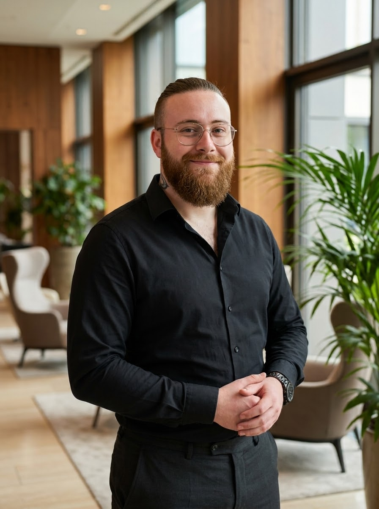

# Hey there! I'm Florian Fenzl 👋

I'm a software developer from the heart of Germany 🇩🇪, currently based in **Düsseldorf**. 

I love exploring new technologies and pushing the boundaries of what's possible with code—from low-level systems and machine learning pipelines to polished web and mobile applications. Over the years, I've collaborated with diverse teams worldwide to craft scalable APIs, data-driven tools, and custom trading strategies. 🌍

---

### 🚀 Featured Projects
Here is a selection of what I’m currently building and maintaining (more on [floriancode.de](https://floriancode.de/)):

* **[Archscript.dev](https://archscript.dev)** – *Developer Tooling & Architecture* ArchScript is an Architecture-as-Code tool for software architects, developers and technical teams
* **[OpenEmployed](https://github.com/schlummer13/openemployed)** – *Platform & Workforce Solutions* All in One Tool for GmbH's & UG's in Germany
* **[SEO Analysis Tool](https://seo.floriancode.de)** – *Automated web auditing, data extraction, and search performance insights*
* **Algorithmic Trading** – *Custom trading strategies, technical indicators, and automated backtesting systems*

---

### 💻 Languages & Tech Stack

**Languages I love working with:**

**Focus Areas & Tools:**
* **Web & App Development:** Modern frontend frameworks, native iOS/macOS apps (Swift), and high-performance backend APIs
* **AI & Data:** Deep Learning, Machine Learning, and data-driven pipelines
* **Infrastructure & Databases:** Distributed systems, Docker, SQL & NoSQL databases

---

### 📬 Connect with me

Let’s build something amazing together! 🚀
